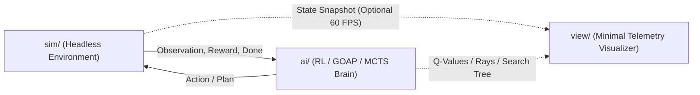

# AI Game Studio

A curated portfolio of **autonomous systems, reinforcement learning environments, and adversarial game-tree AI** built from first principles in **Python (PyTorch / NumPy)** and **Modern C++20**.

Instead of focusing on heavy UI menus or asset pipelines, each project isolates a core **Artificial Intelligence & Machine Learning paradigm** inside a clean, headless-first simulation engine paired with a minimalist real-time telemetry visualizer.

---

## The Three AI Pillars

| # | Project | Stack | Core AI / ML Algorithms | Status |
| :-: | :--- | :--- | :--- | :-: |
| **01** | [**Raycast Survival Arena**](./01_rl_raycast_arena/README.md) | Python 3.12, PyTorch, NumPy, Pygame-CE | Deep Q-Networks (Double DQN), Experience Replay, Polyak Target Sync, 2D LiDAR Perception | Completed |
| **02** | [**Autonomous Tactical Squad**](./02_goap_tactical_squad/README.md) | Modern C++20, Raylib / ANSI Telemetry | Goal-Oriented Action Planning (GOAP), Shared Blackboard, Spatial A* Pathfinding, Steering | Planned |
| **03** | [**AlphaZero-Lite Quoridor**](./03_alphazero_quoridor/README.md) | Python 3.12, PyTorch, NumPy, Pygame-CE | Monte Carlo Tree Search (PUCT), Dual-Head Policy/Value Neural Network, Self-Play RL | Planned |

---

## Architectural Philosophy

All three projects follow strict studio engineering constraints documented in [**docs/ARCHITECTURE_STANDARDS.md**](./docs/ARCHITECTURE_STANDARDS.md):

* **Decoupled Headless Simulation (`sim/` <-> `ai/` <-> `view/`)**: Every game exposes a clean `reset()` / `step(action)` simulation core completely independent of rendering—enabling **1,000x headless training speed** alongside **60 FPS live visual inspection**.
* **Strict <= 250 Lines Per File**: Every module maintains a single, focused responsibility under 250 lines of code.
* **Self-Documenting Code**: Structured docstrings/Doxygen headers on every class and function, full static typing (`mypy`-ready annotations in Python, `constexpr`/`[[nodiscard]]` RAII in C++20), and **zero inline comments** inside function bodies.
* **Live `[1]`–`[4]` Evolutionary Stage Hotkeys**: Every visualizer binds keys `1`–`4` to progressive AI milestones (from untrained/naive baseline up to the converged champion) so progression can be compared live on screen.
* **Interactive Learning Notebooks (`notebooks/`)**: Every project pairs its clean `src/` engine with a pre-executed Jupyter Notebook containing intuitive explanations, math, sensor plots, and multi-panel progression charts.
* **Deterministic Reproducibility**: Explicit seeded PRNGs across environments, search trees, and neural network training runs.



---

## Repository Layout

```text
AI-Game-Studio/
├── docs/
│   └── ARCHITECTURE_STANDARDS.md   # Clean-code & modular architecture contract
├── 01_rl_raycast_arena/            # Deep Reinforcement Learning + Raycast Sensors (Python / PyTorch)
├── 02_goap_tactical_squad/         # Multi-Agent GOAP Planning + A* + Steering (Modern C++20)
├── 03_alphazero_quoridor/          # MCTS + Self-Play Policy-Value Network (Python / PyTorch)
└── LICENSE
```

---

## Prerequisites

* **Python Projects (`01` & `03`)**: Python 3.11+, `torch`, `numpy`, `pygame-ce`
* **C++20 Project (`02`)**: GCC / MinGW-w64 (`g++` with `-std=c++20`)

---

## License

Released under the [MIT License](./LICENSE).
